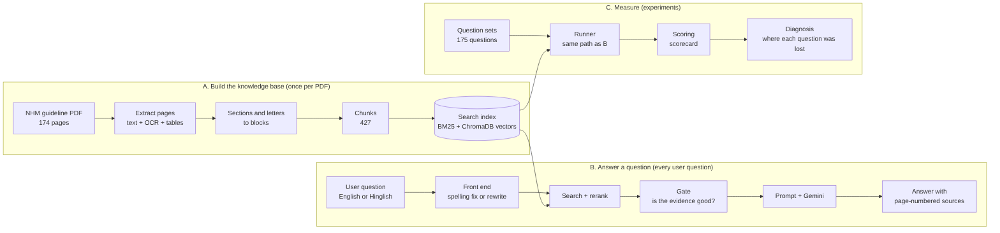

# SwasthyaSetu

**A question-answering chatbot over the National Health Mission guideline *Human Resources for Health for NHM* (2022).**
Ask in English or Hinglish, typos included. It answers only from the guideline, cites the pages it used (printed page and PDF page), and says *"Not found in the guideline."* when the guideline does not cover the question.

> Built for the people who work with this guideline every day: programme managers, HR staff and analysts in state and district health societies who need a rule, a pay norm or a leave policy quickly, with the page to check it against.

Author: **Aman Chaurasia** · October 2026 · [GitHub](https://github.com/amanchaurasia512)

---

## Results

Final run **E5**: the chatbot's own settings, 175 questions, 2 runs each, Gemini flash-lite.

| Metric | E3 (before) | **E5 (chatbot)** | Target |
|---|---|---|---|
| Correct on answerable questions | 79.9% | **85.3%** | ≥ 90% |
| Over-answer on unanswerable questions | 0.0% | **2.2%** (1 question) | ≤ 5% |
| Answer statements with a citation | 80.0% | 79.5% | — |
| Questions that needed a rewrite call | — | 28 of 175 (16%) | — |

The one over-answer is a question with a false premise ("introduced in 1990, right?"). The chatbot corrected it from the guideline (1974) and answered, but the key labels it unanswerable. With that label fixed, the over-answer rate is 0%.

### Model comparison (E6, in progress)

The same pipeline and prompt with 8 models from 4 providers. The run is not finished yet, so models are compared only on the **128 answers all of them have** (Gemma is left out until it catches up):

| Model | Correct | Over-answer | Cited |
|---|---|---|---|
| nvidia: z-ai/glm-5.3-flash | **91.4%** | 2.1% | 73.2% |
| nvidia: nemotron-3-super-120b-a12b | 85.2% | 2.1% | 74.9% |
| gemini: gemini-3.5-flash-lite | 85.2% | 2.1% | **81.6%** |
| groq: qwen/qwen3.8-27b | 82.7% | 2.1% | 79.0% |
| groq: openai/gpt-oss-120b | 81.5% | 8.5% | 71.6% |
| groq: openai/gpt-oss-20b | 81.5% | 14.9% | 61.5% |
| sarvam: sarvam-105b | 58.0% | 14.9% | 73.4% |

Sarvam's low score comes mostly from **empty answers**: in 45 of 244 answers, its reasoning used the whole 4,096-token budget and no answer text came back. Without those it is right on 82%. A re-test with reasoning switched off is planned.

ROUGE-L, BLEU and token F1 against the answer key are also measured (`src/checks/text_metrics.py`). They rank the models differently from correctness (GLM is the most correct but has the lowest overlap), so they are reported as *similarity to the key*, not as accuracy.

---

## How it works



```
question
  → English check: is every word English or in the PDF?   yes → spelling fixer (local, free)
                                                            no  → Gemini rewrite into plain English (1 extra call)
  → hybrid search: BM25 + bge-small vectors, merged by RRF
  → rerank: MS MARCO cross-encoder, top 5
  → gate: grade the evidence   S supported · P weak · M word not in the PDF · I irrelevant (fixed reply, no call)
  → prompt v3b_med + sources in format f0p (printed and PDF page numbers)
  → Gemini answers from the sources only, with [1], [2] citations
```

- **At most 2 LLM calls per question** (rewrite only when needed, then the answer). Search, rerank and the gate run locally on CPU.
- **A fixed workflow, not an agent:** the code decides every step, and rules (the English check, the gate) make the decisions. The same question always takes the same path, so every result can be reproduced, every stage can be tested on its own, and the cost is known in advance.
- **The chatbot runs exactly the path that was scored:** `config/app.yaml` and `config/experiments/e5.yaml` are kept in agreement by a test.

Full workflow diagrams: [`documentation/architecture.md`](documentation/architecture.md).

---

## Quick start

**1. Set up** (Windows, Python 3.10+)
```
python -m venv .venv
.venv\Scripts\activate
pip install -r requirements.txt
pip install -e .
```

**2. API keys** go in a `.env` file in the project root (never committed). Only the providers you use are needed:
```
GEMINI_API_KEY=...
GROQ_API_KEY=...
NVIDIA_API_KEY=...
SARVAM_API_KEY=...
```

**3. Data.** `data/`, `models/` and `runs/` are not in git. Put the guideline PDF in `data/raw/`. Pages, OCR and sections come from notebooks `01`–`05`, blocks from `src/extract/nhm.py`, chunks from `src/chunker.py`. Then check or build the vector index:
```
python -m src.vectordb              # is the index in step with the chunks?
python -m src.vectordb --rebuild    # embed every chunk again
```

**4. Use it**

| What | Command |
|---|---|
| Chat page (dark theme) | `streamlit run app/streamlit_app.py` → http://localhost:8501 |
| One question from the terminal | `python -m src.answer "Can a staff nurse take maternity leave?"` |
| Search only, no LLM | `python -m src.retriever "Can a staff nurse take maternity leave?"` |
| All tests (no API calls, about 12 min) | `python -m pytest tests -q` |

The chat page shows the answer, its sources with PDF pages, and what the system did (gate grade, model calls, seconds). Questions are logged to `data/chat/questions.csv` so repeats can be measured before any cache is added.

---

## Experiments and evaluation

Every experiment runs through one runner, with safety rules built in:

```
python -m src.run --config config/experiments/e5.yaml                  # dry run: shows the plan, calls nothing
python -m src.run --config config/experiments/e5.yaml --allow-api-calls  # real run
python -m src.run --resume <run_id> --allow-api-calls                  # answer only what is missing
python -m src.diagnose <run_id> [--model <model>]                      # where each question was lost
python -m src.checks.text_metrics <run_id>                             # ROUGE-L, BLEU, token F1
```

- **API calls happen only with `--allow-api-calls` typed on the command line.** No config file can switch them on.
- Every run gets its own folder `runs/<id>/` with `manifest.json` (commit, config, data fingerprints), `evidence.jsonl`, `traces.jsonl`, `answers.csv`, `run.log`, `scored.csv` and `scorecard.csv`.
- A resumed run refuses to continue if the settings or the question files changed.

**What is measured**

| Measure | Meaning |
|---|---|
| Correctness | the expected facts are in the answer (key words and every number) |
| Over-answer | answering a question the guideline does not cover (the hallucination measure) |
| Unwarranted refusal | refusing although the facts were in the prompt |
| Citation recall / precision | statements with a citation; citations that point to the right source |
| Prompt rule checks | refuse only when nothing is found, numbers only from the sources, cite every statement, length fits the question, complete lists |
| Diagnosis (`lost_at`) | the first stage that lost a question: index, retrieval, gate, context, model refused, model incomplete |

Every change is tested **on vs off**, one change at a time, with the pass rule written down before the check. A regression test replays the frozen E2 results exactly.

---

## Project layout

```
app/                 Streamlit chat page
config/
  base.yaml          settings for any document (old values kept as switches)
  app.yaml           the chatbot's settings
  docs/              one file per PDF (nhm_hrh_2022.yaml)
  experiments/       one file per experiment (e2, e3, e5, e6)
src/
  extract/nhm.py     everything particular to this PDF
  chunker.py         blocks → chunks (text by size, tables by STC)
  vectordb.py        ChromaDB index
  retriever.py       BM25 + vectors + RRF + rerank
  corrective.py      the gate (S / P / M / I)
  rewrite.py         English check and LLM rewrite
  prompts.py         prompts and source formats
  llm.py             one interface for Ollama, Gemini, Groq, NVIDIA, Sarvam
  pipeline.py        one question, end to end
  chat.py            the chatbot session
  run.py             experiment runner
  evaluate.py        scoring
  diagnose.py        where questions were lost
  checks/            stage-by-stage checks and text metrics
tests/               tests for every stage, plus the E2 regression
notebooks/           exploration and history (experiments no longer run from here)
documentation/       project summary and architecture
```

A new PDF needs a new `config/docs/<doc>.yaml` and its own extractor; the rest is document-independent.

---

## Limitations

- Below the 90% target: some answers are incomplete although the facts were in the prompt.
- Names typed differently from the PDF ("Jhalni" for "Jhalani") are not corrected.
- Real-word mistakes ("preference" for "performance") are not fixed by the spelling fixer or the rewrite.
- Not searchable yet: the salary table, the front matter and the senders of letters.
- Questions with unknown words need the Gemini API and cost two calls.
- Fact questions only: a request like "summarise chapter 1" needs a different path (whole chapter, map-reduce).
- The gate, the English check and the prompt were tuned on this PDF; with 175 questions, one question moves a score by about 0.6 points; the scorer is lexical (it counts an empty answer as "answered" and misses long refusals).

## Future work

- A check after the answer: is every sentence supported by the sources (MiniCheck, HHEM).
- A summary path for chapter and section questions.
- A small local rewriter trained on the Gemini rewrites, then other Indian languages.
- Index fixes (salary table, front matter, letter senders), a FastAPI endpoint, a second PDF.

## Credits

Methods from CRAG (the gate), STC (table chunking), Trust-Score (refusal and citation measures), RAGChecker and the Seven Failure Points of RAG (diagnosis), ConInstruct (prompt rule checks), QE-RAG (query rewriting), RRF, BM25, BGE and MS MARCO. Models from Google, Groq, NVIDIA and Sarvam. Claude (Anthropic) helped with design, code and documentation.
