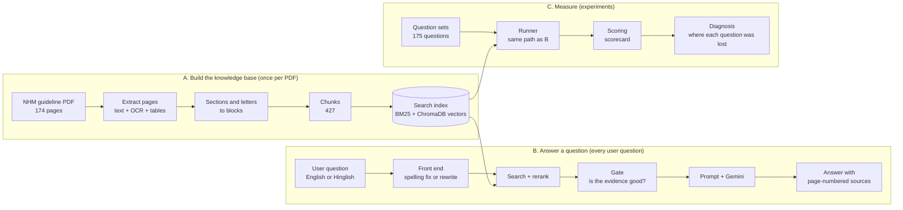
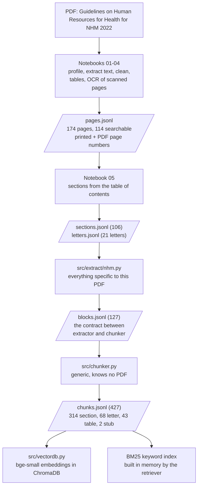
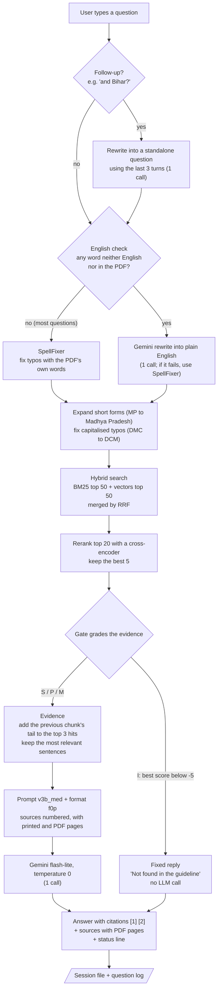
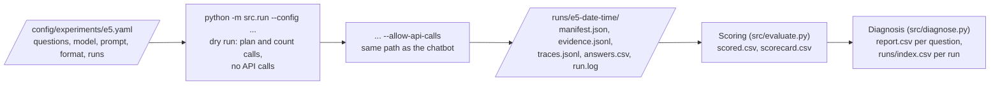
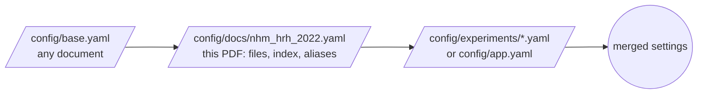

# SwasthyaSetu — Architecture

How the whole system works, from the PDF to an answer on screen, and how every answer is measured.
The diagrams are written in Mermaid, so GitHub draws them directly from this file.

---

## 1. The big picture

The project has three parts that share one set of code and one set of settings:



- **Part A** turns the PDF into searchable chunks. It runs once; its output files are frozen and fingerprinted.
- **Part B** is the chatbot: the Streamlit page and `src/chat.py`.
- **Part C** runs the same path as Part B over fixed question sets, scores every answer and explains every miss. A test keeps the chatbot's settings (`config/app.yaml`) and the final experiment's settings (`config/experiments/e5.yaml`) identical, so the scores describe exactly what users get.

---

## 2. Part A — from PDF to search index



| Step | Code | What it does |
|---|---|---|
| Extract | notebooks 01–04 | Reads every page; scanned pages go through OCR; tables are read row by row; each page keeps both its **printed** and its **PDF** page number. Front matter and messages are stored but not searched. |
| Sections | notebook 05 | Splits the text into sections using the table of contents; the 21 letters of the Annexure II compendium become separate units. |
| Blocks | `src/extract/nhm.py`, `src/blocks.py` | Repacks sections and letters into **blocks**, the one format every extractor must produce. All NHM-specific knowledge lives here, so a second PDF needs only a new extractor. `blocks.validate()` checks the format. |
| Chunks | `src/chunker.py` | Small sections stay whole (up to 1,400 characters); larger ones are split at about 1,000 characters on sentence boundaries with a one-sentence overlap; no chunk exceeds 1,600. Tables are chunked with **STC**: the header is repeated with every group of rows. |
| Index | `src/vectordb.py`, `src/retriever.py` | One **bge-small-en-v1.5** vector per chunk in ChromaDB (each record keeps a fingerprint of its text, so a changed chunk is noticed), plus a **BM25** keyword index. |

Each chunk carries its path in the document (e.g. *Chapter 6 > 6.1 Joining Formalities*), its PDF and printed pages, its type and its source (text or OCR).

---

## 3. Part B — how a question is answered



### 3.1 Front end (`src/rewrite.py`, `src/query.py`)
- **Follow-ups**: a short message or one with "it / they / and …" after earlier turns is rewritten into a full question from the conversation history. History is used only for this, never as a source for the answer.
- **English check** (`rewrite.needed`): if every word is an English word or appears in the PDF, the question goes to **SpellFixer**, which fixes typos using the guideline's own vocabulary. If any word is unknown (a Hindi word or a typo), Gemini rewrites the question into plain English: it fixes spelling and translates Hinglish, and keeps names, numbers, dates and abbreviations exactly as written. Abbreviations in capitals and capitalised names inside a sentence never trigger a rewrite, because the rewrite must keep them unchanged anyway.
- **Aliases and capitalised typos**: Indian short forms the PDF writes out (MP, UP, TN, ICU …) are expanded, and capitalised typos are matched to the PDF's own abbreviations.

### 3.2 Retrieval (`src/retriever.py`)
- **BM25** (keywords) and **vector search** (bge-small, meaning) each return their top 50 chunks.
- **RRF** (reciprocal rank fusion) merges the two lists.
- A **cross-encoder reranker** (MS MARCO MiniLM-L-6) re-scores the top 20 against the question and keeps the best 5; the hybrid search's first hit is never pushed below rank 5.

### 3.3 Gate (`src/corrective.py`, after CRAG)
The gate looks at the rerank scores and at the question's important words and decides whether the evidence is good enough:

| Grade | Rule | Action |
|---|---|---|
| **I** irrelevant | best rerank score below −5 | fixed reply "Not found in the guideline", no LLM call |
| **M** missing word | a key word (e.g. a name or organisation) or a year in the question appears nowhere in the PDF | sent to the LLM with its evidence (the model refuses when the sources do not cover it) |
| **P** partial | a minor word is not in the PDF, or a word that is in the PDF is not in the 5 hits, or the best score is below 0 | sent to the LLM |
| **S** supported | everything found | sent to the LLM |

### 3.4 Evidence and prompt (`src/answer.py`, `src/prompts.py`)
- For the top 3 hits, the last 700 characters of the previous chunk of the same section are put in front, so a chunk that starts mid-paragraph gets its beginning back.
- In text chunks of more than five sentences, the two sentences closest to the question (by the reranker) are kept with one sentence on each side; tables are kept whole.
- **Prompt `v3b_med`**: answer only from the sources; decide first, in order: topic not covered → "The guideline does not cover …"; a false premise → correct it from the sources; asked for one state/year/cadre but the sources cover another → say so; partly answered → answer that part and say what is missing; nothing found → "Not found in the guideline"; otherwise answer. Cite the source number after every fact; read tables row by row; short answers for single facts, full bullet lists for lists.
- **Format `f0p`**: every source is numbered and shows its path, **printed page and PDF page**, so the answer can say exactly where to look.

### 3.5 Model and response
- **Gemini 3.5 flash-lite**, temperature 0, through its OpenAI-compatible endpoint (`src/llm.py`, with retries for timeouts and rate limits).
- The page shows the answer, an expandable list of sources (`[1] PDF page 37 – C6-01`) and a status line: what the system did, the gate grade, the number of model calls, the seconds, and the searched question when it was rewritten.
- Every turn is saved to the session file, and one row goes to the **question log** (`data/chat/questions.csv`: time, question with e-mails and phone numbers hidden, rewritten or not, grade, action, calls, seconds), which later shows whether repeated questions justify a cache.

### 3.6 Cost per question

| Question | Model calls |
|---|---|
| Not covered by the guideline (gate I) | 0 |
| Clean English | 1 |
| Typos or Hinglish | 2 (rewrite + answer) |
| Follow-up in a conversation | +1 |

On the 175 benchmark questions, 28 (16%) needed the rewrite.

---

## 4. Part C — experiments and evaluation



- **Runner** (`src/run.py`): the only code that calls the model in experiments. Without `--allow-api-calls` it is a dry run that plans and counts calls. Each answer is saved the moment it arrives; a stopped run continues with `--resume` and skips saved answers; a resume is refused if the settings or a question file changed.
- **Manifest**: the run's ID card — git commit and whether the code had uncommitted changes, Python and package versions, the full merged settings and their hash, fingerprints of every input file, the plan and the progress.
- **Evidence and traces**: for every question, the fixed or rewritten question, the hits with all their fields, the gate signals and grade, the exact prompt (by hash) and the seconds per stage.
- **Scoring** (after Trust-Score): correct on answerable questions (a fact counts when half its key words and every number of two or more digits appear in the answer), over-answer on unanswerable questions, and statements cited; one row per answer in `scored.csv`, the totals in `scorecard.csv`.
- **Diagnosis** (after RAGChecker and the Seven Failure Points): for every question, the first stage that lost it — `index` (fact not in any chunk), `retrieval` (not in the hits), `gate` (blocked), `context` (not in the prompt), `llm_refused`, `llm_incomplete`, or `ok`; for unanswerable questions, `over_answer` or `ok`. `runs/index.csv` lists every run with its score and stage counts.

---

## 5. Settings

One set of YAML files, merged in layers (later wins):



| Setting | Value | Where |
|---|---|---|
| Embedding model | BAAI/bge-small-en-v1.5 | `retrieval.embed_model` |
| Reranker | ms-marco-MiniLM-L-6-v2 | `retrieval.rerank_model` |
| Hybrid pool / RRF constant / rerank pool / kept hits | 50 / 60 / 20 / 5 | `retrieval.*` |
| Gate cut-offs | I below −5, P below 0 | `gate.lower`, `gate.upper` |
| Front end | `rewrite_if_unknown` (app, E5); `spellfixer` in base | `query.front_end` |
| M questions | sent to the LLM (`answer`) | `gate.m_action` |
| Chunk sizes | target 1,000, keep whole 1,400, max 1,600 characters | `chunker.*` |
| Model, prompt, format | Gemini flash-lite, `v3b_med`, `f0p` | `chat.*`, experiment `plan` |
| Temperature | 0 | `llm.temperature` |

API keys live only in `.env` (never committed); no settings file can switch API calls on.

---

## 6. Code map

```
SwasthyaSetu/
├── app/streamlit_app.py        chat page (dark theme in .streamlit/config.toml)
├── config/                     base.yaml · docs/nhm_hrh_2022.yaml · app.yaml · experiments/e2, e3, e5.yaml
├── src/
│   ├── extract/nhm.py          PDF-specific: sections and letters to blocks
│   ├── blocks.py               block format and its checks
│   ├── chunker.py              blocks to chunks (generic, STC tables)
│   ├── vectordb.py             ChromaDB index: status, build, open
│   ├── retriever.py            BM25 + vectors + RRF + rerank
│   ├── query.py                SpellFixer (PDF vocabulary)
│   ├── rewrite.py              English check + live Gemini rewrite
│   ├── corrective.py           gate: signals, grades S/P/M/I, evidence
│   ├── answer.py               evidence helpers, refusal text
│   ├── prompts.py              prompt versions, source formats, rewrite instruction
│   ├── pipeline.py             load questions · prepare (front end → gate) · build the prompt
│   ├── llm.py                  model calls with retries (Gemini, Groq, NVIDIA, Ollama)
│   ├── chat.py                 the chatbot: follow-ups, session, question log
│   ├── run.py                  experiment runner (dry run by default)
│   ├── trace.py                trace lines and log lines
│   ├── evaluate.py             scoring and scorecard
│   ├── diagnose.py             where each question was lost
│   ├── names.py                candidate names from the PDF (evidence for the report)
│   └── checks/                 level checks used to make the decisions
├── tests/                      139 tests, no API calls
├── data/                       PDF, extracted files, index, question sets, chat log (not in git)
├── runs/                       one folder per experiment run (not in git)
└── docs/                       restructure report (LaTeX), images
```

---

## 7. Rules the system follows

| Rule | What it means |
|---|---|
| API calls only on purpose | Experiments call a model only with `--allow-api-calls` typed on the command line; dry run by default. |
| One change at a time | Every change has an ID in the change log, is measured, and is a config switch with the old value kept, so earlier runs stay reproducible. |
| Keep going | A failing stage or call is recorded with its stage and question; the run or chat carries on. |
| Answer only from the guideline | The prompt forbids outside knowledge; out-of-scope questions get a fixed reply without a model call. |
| Same path everywhere | The chatbot and the final experiment use the same code and the same settings, checked by a test. |
| Tested | 139 tests, all without API calls, including a full replay of an earlier experiment (E2) that must give identical results. |
